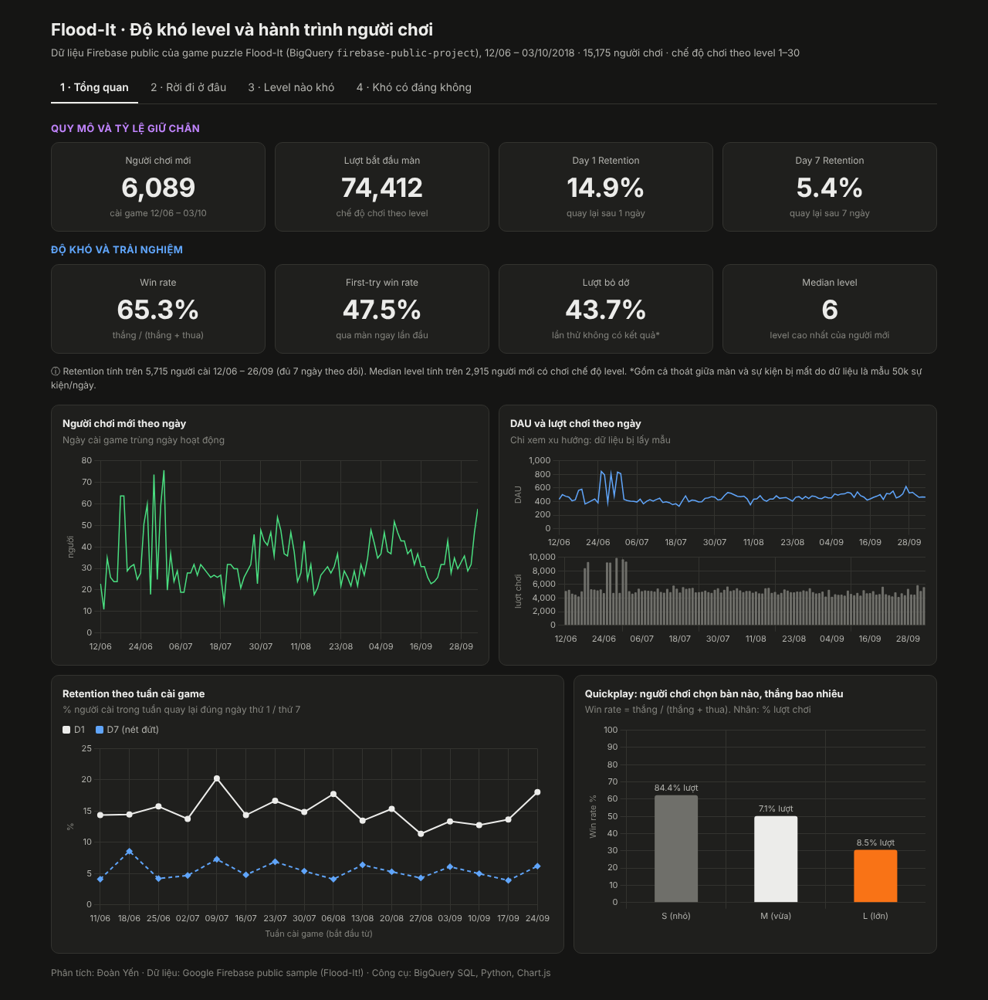

# Phân tích độ khó màn chơi và hành trình người chơi – Flood-It

Dự án phân tích dữ liệu game mobile trên bộ dữ liệu Firebase công khai của game giải đố **Flood-It** (Google BigQuery). Mục tiêu là tìm những level đang khó quá mức, đánh giá việc giảm độ khó có mang lại lợi ích hay không, và đề xuất các thử nghiệm A/B để kiểm chứng.

- 📊 **Dashboard:** [Looker Studio](LINK_LOOKER) · [bản HTML](dashboard/index.html)
- 📄 **Báo cáo đầy đủ:** [Bao_cao_FloodIt_do_kho_level.pdf](report/Bao_cao_FloodIt_do_kho_level.pdf)



## Kết quả chính

| Phát hiện | Số liệu |
|---|---|
| Đoạn level 5–9 làm mất nhiều người chơi mới nhất | Mất **39%** tổng số người chơi mới chỉ trong 5 level |
| Độ khó tăng đột ngột từ level 4 sang level 5 | Tỷ lệ thắng giảm từ **93%** xuống **58%** |
| Level 27 là điểm rời bỏ lớn nhất | **38%** người chơi đến level 27 rời bỏ game; tỷ lệ thắng **7%** |
| Level càng khó, tỷ lệ rời bỏ càng cao | Hệ số tương quan Spearman **−0,81** (p < 0,001) |
| Độ khó vừa phải tăng mức sử dụng thêm bước đi | Cao gấp khoảng **3 lần** so với level dễ cùng giai đoạn |

**Đề xuất:** giảm độ khó level 27, bổ sung level trung gian giữa level 4 và 5, cải thiện hướng dẫn ở level 1–2. Mỗi đề xuất đi kèm thiết kế thử nghiệm A/B (giả thuyết, chỉ số chính, chỉ số bảo vệ, cỡ mẫu).

## Dữ liệu

- Nguồn: `firebase-public-project.analytics_153293282` trên Google BigQuery (dữ liệu công khai)
- Phạm vi: 12/06 – 03/10/2018, 15.175 người chơi, 5,7 triệu sự kiện, 30 level

### Kiểm tra chất lượng dữ liệu

| Vấn đề | Cách xử lý |
|---|---|
| Dữ liệu là mẫu (mỗi ngày đúng ~50.000 sự kiện) | Chỉ so sánh tỷ lệ, không kết luận theo số tuyệt đối |
| 60% người chơi đã cài game trước kỳ dữ liệu | Phễu và tỷ lệ rời bỏ chỉ tính người chơi mới |
| Thứ tự sự kiện không nhất quán | Đếm sự kiện theo người chơi × level thay vì ghép theo thời gian |
| Chơi lại thường không ghi nhận "bắt đầu màn" | Lần thử = bắt đầu màn + chơi lại, loại 13.736 lần đếm trùng |
| 43,7% lần thử không có kết quả | Tỷ lệ thắng = thắng / (thắng + thua) |

## Công cụ

| Công cụ | Vai trò |
|---|---|
| Google BigQuery (SQL) | Lưu trữ, làm sạch và tổng hợp dữ liệu |
| Python (pandas, scipy) | Kiểm định thống kê, mô hình đánh đổi, tính cỡ mẫu A/B test |
| Looker Studio | Dashboard |

## Cấu trúc thư mục

```
├── sql/floodit_queries.sql        # Toàn bộ truy vấn BigQuery: khám phá, làm sạch, tính chỉ số
├── data/                          # Kết quả tổng hợp xuất từ BigQuery
├── analysis/
│   ├── 01_metrics_and_correlation.py   # Retention gộp, tương quan, chỉ số theo level
│   └── 02_tradeoff_model.py            # Mô hình đánh đổi và ngưỡng hòa vốn
├── dashboard/index.html           # Bản dashboard HTML
├── report/                        # Báo cáo PDF
└── images/                        # Ảnh chụp dashboard
```

## Chạy lại phân tích

1. Tạo project Google Cloud (bản sandbox miễn phí), tạo dataset `floodit` ở vùng **US**.
2. Chạy lần lượt các khối trong `sql/floodit_queries.sql` trên BigQuery.
3. Chạy phần Python:

```bash
pip install -r requirements.txt
python analysis/01_metrics_and_correlation.py
python analysis/02_tradeoff_model.py
```

## Hạn chế

- Dữ liệu là mẫu nên các con số tuyệt đối và tỷ lệ giữ chân có thể thấp hơn thực tế.
- Dữ liệu không có doanh thu, nên mô hình đánh đổi dùng số lần thêm bước đi làm đơn vị đo.
- Dữ liệu từ năm 2018; kết quả mang tính minh họa phương pháp, không đánh giá phiên bản hiện tại của game.

## Tác giả

**Đoàn Yến** 
